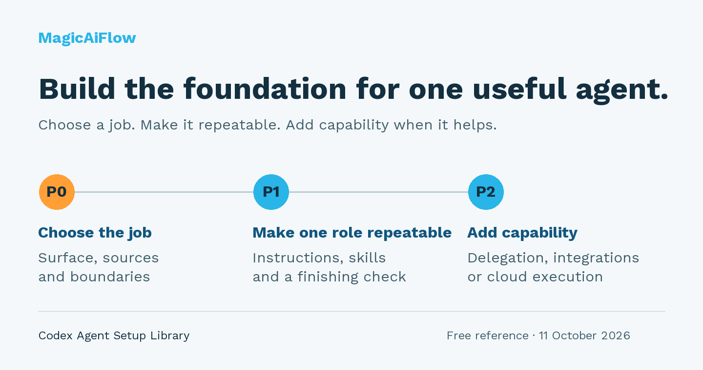
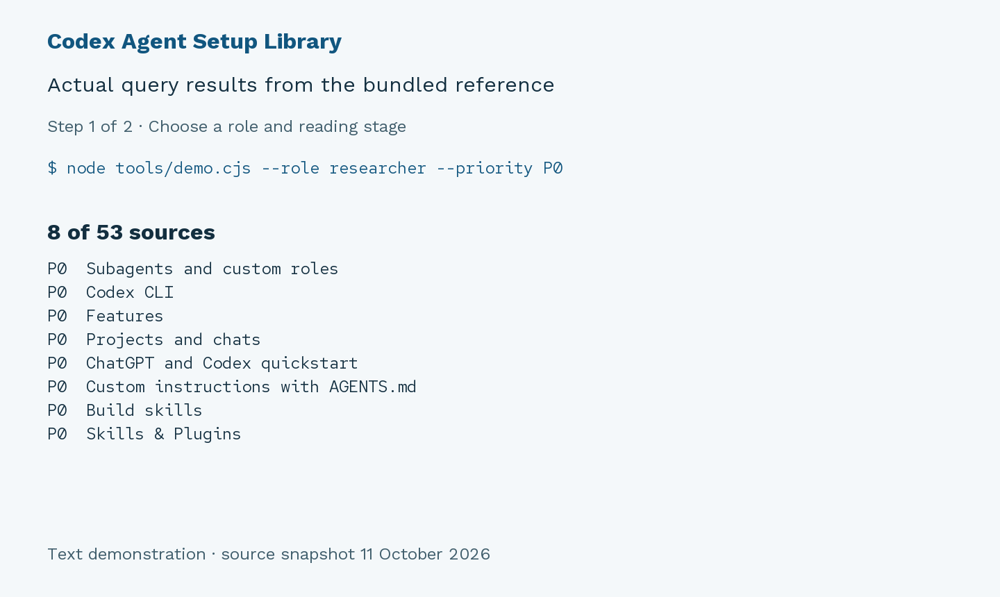

# Codex Agent Setup Library

A free, source-linked reference and starter workspace for people beginning with Codex. Understand where files belong, complete one small research task, and check the result against real sources.



## Start with one task

**[Follow the starter walkthrough](docs/start-here.md)** → [complete the task](docs/first-task.md) → [check the worked example](examples/first-task-source-brief.md).

Prefer a web reading guide? **[Open the free GitBook walkthrough](https://magicaiflow-llc.gitbook.io/codex-agent-starter-kit/)**. GitHub remains the source for the files and downloads; the GitBook companion is updated manually.

The task produces a short brief explaining project instructions, custom roles and reusable skills. The workspace includes instructions, a skill, two optional roles, three dated source notes and an output template.

**[Download the free starter workspace](https://github.com/Marian2250/codex-agent-setup-library/releases/latest/download/codex-agent-starter-kit.zip)** and open the extracted folder in your existing Codex setup. Keep the hidden `.agents` and `.codex` folders. The exercise needs no new API key, service or package installation; your AI account and its normal usage limits still apply.

Browse [the starter files](starter-kit/workspace/), [the full file map](docs/file-map.md), or [the local/cloud guide](docs/local-and-cloud.md).

## Read the complete library

**[Download the complete free library](https://github.com/Marian2250/codex-agent-setup-library/releases/latest/download/codex-agent-setup-library.zip)**, unzip it, and open `index.html` in your browser. Keep the extracted folder together so the source-data and example links work.

No installation, signup or payment is required to read the downloaded reference. Searching, filtering and shortlist export use JavaScript in your browser. Following the official documentation links requires internet access. Codex access and feature availability are separate from this library.

Prefer individual files? Browse [the HTML](index.html), [structured source data](library.json), and [the planning worksheet](examples/agent-brief.md). GitHub's file view shows the HTML source; opening the downloaded HTML gives you the interactive library. The complete download also contains the starter workspace and walkthrough.

## What is inside

- **53 references** linking directly to OpenAI documentation, with summaries and editorial notes.
- **Three reading paths:** P0 foundations, P1 repeatable specialists, P2 optional extensions.
- **A file map:** personal and project instructions, agent roles, skills, command rules and configuration.
- **Six role families:** manager, researcher, builder, reviewer, automation and business operations.
- **Search and filters:** execution surface, role, priority and topic.
- **A local shortlist:** save relevant entries and export them as JSON.
- **An agent brief:** define the job, sources, boundaries, ownership, checks and operating limits.
- **A starter workspace:** complete one source-backed brief, with a worked example and seven linked guide pages.

The reading priorities and role tags are recommendations. They are separate from the facts in the linked documentation.

## Find sources for your own next task

You want an agent to help research a technical question without changing your project.

1. Open the library and go to **Source library**.
2. Set **Agent type → Researcher / analyst** and **Priority → P0 · Foundation**.
3. Search for **AGENTS.md** to find the relevant instruction references.
4. Save useful sources, then choose **Export shortlist**. Your browser downloads JSON containing your selected entries.
5. Complete [the blank brief](examples/agent-brief.md). Compare your draft with [the completed research example](examples/research-agent-brief.md).

The example is a planning exercise. It does not install an agent or run a research job.



This short demonstration visualizes actual query results from the bundled library. It is a text-based demonstration, not a browser recording. A [plain-text transcript](examples/demo-transcript.txt) contains the same results.

## Choose a reading path

| Stage | Decide this first | Read next |
| --- | --- | --- |
| P0 | What is the job, where will it run, and what may it do? | Instruction layers, config basics, permissions and the file map |
| P1 | How can one role produce repeatable work? | Custom roles, skills, rules and verification |
| P2 | Which additional capability does the task actually need? | Delegation, integrations, cloud environments or application runtimes |

Start with one role and one concrete task. The library explains local Codex, CLI, desktop, cloud and application surfaces; their settings and access do not automatically transfer between products.

## Shortlist and printing

Selections are stored locally when your browser permits local storage for file URLs. If persistence is unavailable, export the shortlist before closing the page. There is no account sync or server storage.

**Print / save PDF** opens your browser's print dialog. It prints the currently visible entries, and expands their notes for printing. Clear filters first to include the complete library.

## Source and edition notes

Edition **1.1.0**, based on the **11 October 2026** research snapshot. The completed first-task example was produced from the included notes and checked in a copied workspace. It is separate from native discovery and hosted execution checks.

This is an independent MagicAiFlow reference. OpenAI documentation remains with its original publisher; this library is not an OpenAI product or endorsement.

Check current official documentation and your installed version before applying configuration. See [SOURCES.md](SOURCES.md) for provenance and limits, and [USAGE.md](USAGE.md) for access and reuse notes.

## Check or contribute

Found a broken link or a confusing explanation? [Open an issue](https://github.com/Marian2250/codex-agent-setup-library/issues) with the source title and suggested correction. Keep credentials and private project information out of public issues.

Optional developer checks use the installed Node.js and Python standard library:

```sh
node --test tests/library.test.cjs
python3 tools/verify.py
python3 tools/verify-starter.py
node tools/demo.cjs --query AGENTS.md --role researcher --priority P0
```

No package installation is needed. Starter checks use Python 3.11 or newer; the browser library works without Node.js or Python.

Made by **MagicAiFlow**. The entire reference is free.
